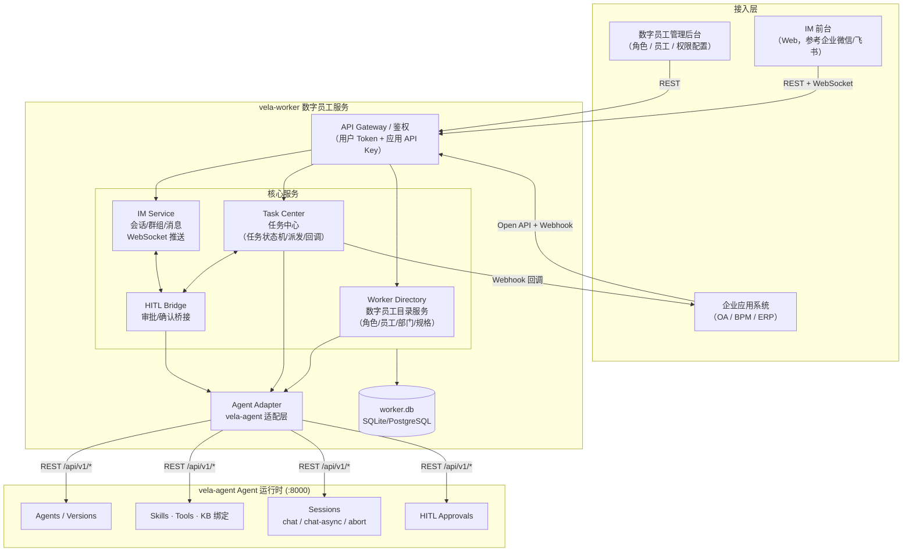
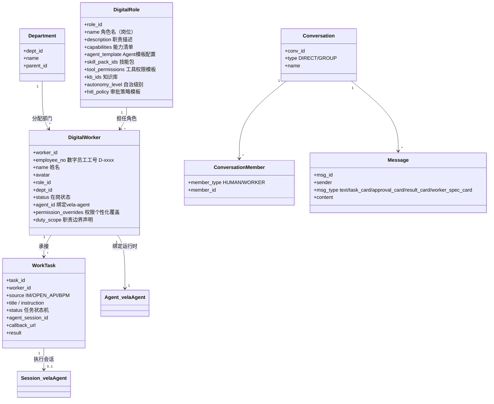
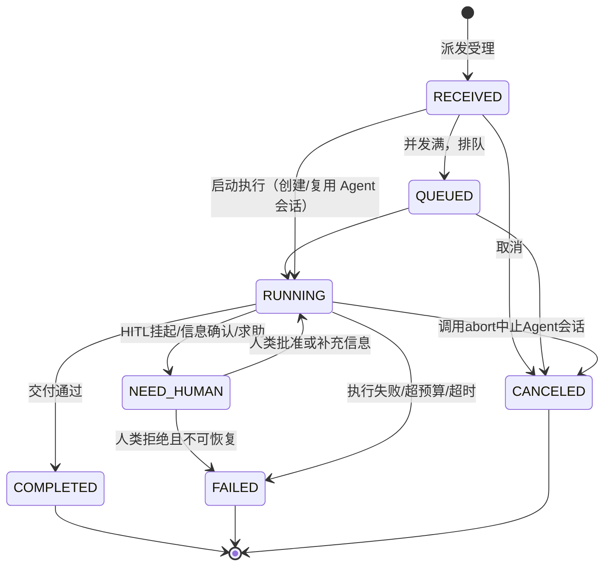
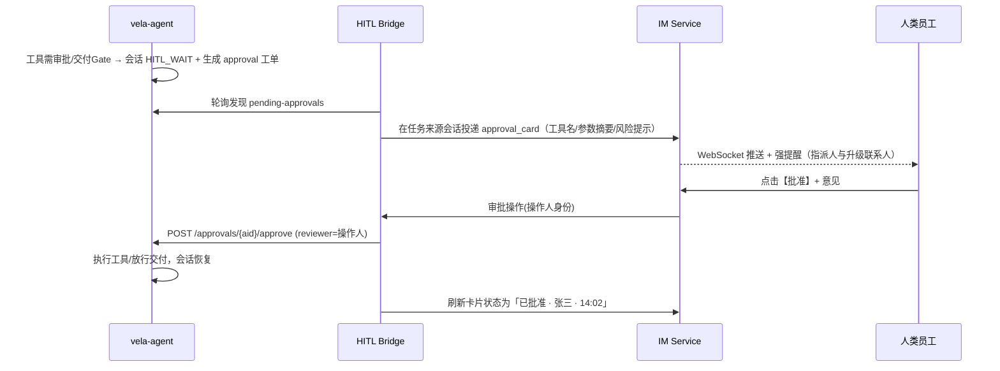
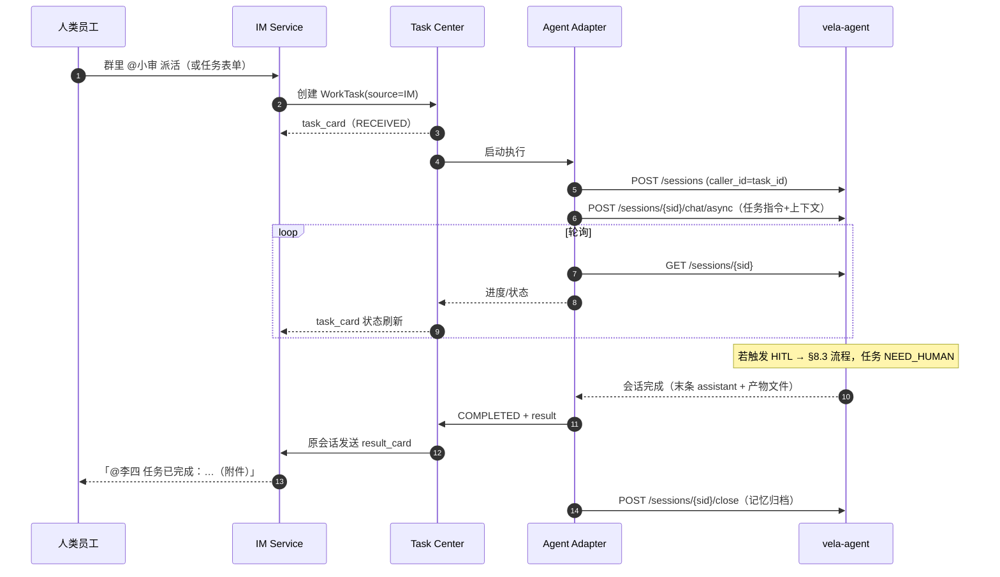
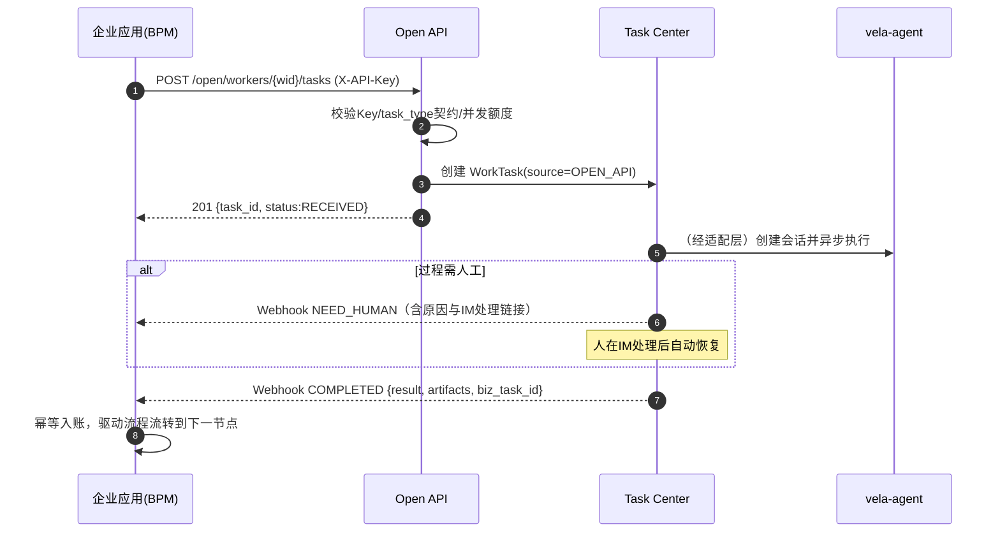

# Vela·Worker — AI Agent 数字员工服务 整体方案设计

> 版本：v1.0　|　定位：企业数字员工服务层（vela-worker），Agent 运行时复用 **vela-agent**（Vela Agent Playground）
>
> 理念：**像 HR 提供新员工一样，为企业各部门提供基于 AI Agent 的数字员工服务。**

---

## 目录

1. [概述与系统定位](#1-概述与系统定位)
2. [总体架构](#2-总体架构)
3. [核心领域模型](#3-核心领域模型)
4. [数字员工规格定义（Worker Spec）](#4-数字员工规格定义worker-spec)
5. [开放接口定义（Open API）](#5-开放接口定义open-api)
6. [即时通信（IM）设计](#6-即时通信im设计)
7. [数字员工配置管理](#7-数字员工配置管理)
8. [vela-agent 集成适配层](#8-vela-agent-集成适配层)
9. [关键业务流程时序](#9-关键业务流程时序)
10. [数据模型设计](#10-数据模型设计)
11. [安全与治理](#11-安全与治理)
12. [技术选型与部署](#12-技术选型与部署)
13. [实施路线](#13-实施路线)

---

## 1. 概述与系统定位

### 1.1 背景

企业已通过 **vela-agent** 平台支持定制可执行各业务领域任务的 AI Agent（单体 Agent / 多 Agent 编排 / 工作流型三种类型，具备技能包、工具、知识库、HITL 审批、记忆等完整能力）。

**vela-worker** 在其之上构建"数字员工"服务层，解决的核心问题是：**Agent 只是一个可调用的能力，而数字员工是一个有组织身份、有职责边界、可被派活、可被问责的"员工"。**

### 1.2 需求映射

| 原始需求 | 本方案对应模块 |
|---|---|
| 作为特殊员工类型进入组织机构，可接收流程任务并像人类员工一样处理 | §3 领域模型（组织身份）、§5 开放接口（任务派发） |
| 用户通过前台对话框与数字员工会话：信息查询、任务指派、完成后自动答复、过程中可向人类确认/审核/求助 | §6 IM 设计、§8.3 HITL 桥接 |
| 企业应用通过开放接口派发任务、接受结果反馈 | §5 开放接口（任务 API + Webhook 回调） |
| 数字员工规格定义、任务接收/响应反馈接口定义 | §4 Worker Spec、§5 Open API |
| IM 工具：工作组群聊、添加人类/数字员工、数字员工规格显示 | §6 IM 设计 |
| 角色（技能/工具/知识库）→ 数字员工（名称/角色/部门）→ 权限个性化覆盖 | §7 配置管理 |

### 1.3 系统边界

```
┌─────────────────────────────────────────────────────────────┐
│  企业侧                                                       │
│  · 组织机构/HR 系统（部门、员工目录）                            │
│  · 企业应用系统（OA/BPM/ERP…，流程任务的产生方）                 │
│  · 人类员工（IM 前台用户、审批人）                               │
└──────────────────────────┬──────────────────────────────────┘
                           │
┌──────────────────────────▼──────────────────────────────────┐
│  vela-worker  数字员工服务（本方案新建）                        │
│  数字员工目录 · 角色管理 · 任务中心 · IM 服务 · 开放接口 · HITL桥 │
└──────────────────────────┬──────────────────────────────────┘
                           │  REST（内部适配层调用）
┌──────────────────────────▼──────────────────────────────────┐
│  vela-agent  Agent 运行时（复用现有实现，端口 8000）             │
│  Agent(SINGLE/COMPOSITE/WORKFLOW) · Skills · Tools · KB       │
│  Sessions(chat/chat-async/abort) · HITL Approvals · Memory    │
└─────────────────────────────────────────────────────────────┘
```

**职责划分原则**：vela-agent 负责"怎么干"（推理、编排、工具执行、审批挂起）；vela-worker 负责"谁来干、干什么、干到什么程度、向谁汇报"（身份、任务、通信、回调）。vela-worker 不修改 vela-agent 代码，仅通过其现有 REST API 集成。

---

## 2. 总体架构



### 2.1 模块职责

| 模块 | 职责 |
|---|---|
| **Worker Directory** | 数字员工角色（岗位模板）与数字员工实例的全生命周期管理；组织机构挂接（部门/工号/员工类型）；规格卡片（Worker Spec Card）生成 |
| **Task Center** | 统一任务模型与状态机；接收 IM 指派与开放 API 派发的任务；驱动 Agent 执行；任务结果回传（IM 答复 + Webhook 回调） |
| **IM Service** | 单聊/群聊会话、成员管理（人类+数字员工）、消息收发与 WebSocket 实时推送、@提及路由、消息卡片（任务卡/审批卡/结果卡/规格卡） |
| **HITL Bridge** | 将 vela-agent 的 HITL 审批工单、信息确认需求转化为 IM 中的交互卡片；将人类的批准/拒绝/补充信息回传 vela-agent 恢复执行 |
| **Agent Adapter** | 封装 vela-agent REST API：Agent 创建与绑定、会话管理、异步对话、状态轮询、审批操作；隔离上游接口变化 |

---

## 3. 核心领域模型

### 3.1 概念总览



### 3.2 关键设计决策

**D1 — 数字员工 = 组织身份 + 角色能力 + Agent 执行体（三层解耦）**

- **组织身份**：工号（`D-` 前缀特殊员工类型）、姓名、部门、在岗状态 —— 使数字员工可被 HR/组织系统同步，作为"特殊员工类型进入组织机构"，可成为流程任务的合法处理人。
- **角色（DigitalRole）**：岗位级能力模板 —— 技能包、工具及权限、知识库、自治级别、HITL 策略。一个角色可被多个数字员工复用（如"应收会计"角色 → 财务一部/二部各一名数字员工）。
- **Agent 执行体**：每个数字员工在 vela-agent 侧对应**一个独立 Agent 实例**（创建员工时由适配层按角色模板自动创建并完成技能/工具/知识库绑定）。独立实例保证：权限个性化覆盖互不影响、记忆按员工隔离、Token 预算与审计按员工核算。

**D2 — 任务是一等公民**。IM 里的一次指派、开放接口的一次派发、BPM 的一个待办，统一收敛为 `WorkTask`，走同一状态机、同一执行链路、同一审计口径。IM 会话中的普通"信息查询"不生成任务（直接走会话对话），只有显式指派（@员工 + 任务语义/任务卡）才生成任务。

**D3 — 人机协同通过 IM 完成闭环**。vela-agent 已实现工具级 HITL（`require_approval`）与交付级 HITL（MA 交付 Gate、WF 审批节点），会话挂起为 `HITL_WAIT` 并产生审批工单。vela-worker 不重复实现审批引擎，只做**桥接**：把工单渲染成 IM 审批卡片投递给相关人类员工，把点击结果回调 vela-agent 的 approve/reject 接口恢复执行。

---

## 4. 数字员工规格定义（Worker Spec）

Worker Spec 是数字员工的"名片 + 岗位说明书 + 服务契约"，用于：① IM 中展示（添加成员、查看资料）；② 开放接口的能力发现（企业应用判断能否派发某类任务）；③ 治理审计（职责边界、权限、审批策略留档）。

### 4.1 规格结构（JSON Schema 摘要）

```json
{
  "spec_version": "1.0",
  "identity": {
    "worker_id": "wk-7f3a…",
    "employee_no": "D-10086",
    "name": "小审",
    "avatar": "https://…/xiaoshen.png",
    "employee_type": "DIGITAL",
    "dept_id": "dept-audit-01",
    "dept_name": "审计部",
    "role_name": "经济责任审计助理",
    "status": "ON_DUTY",
    "onboard_date": "2026-08-01"
  },
  "profile": {
    "description": "负责经济责任审计立项资料收集、风险初筛与报告初稿撰写。",
    "duty_scope": [
      "审计立项资料收集与整理",
      "被审计对象风险初筛",
      "审计报告初稿撰写"
    ],
    "out_of_scope": [
      "最终审计结论签发",
      "对外发布任何审计结果"
    ],
    "service_hours": "7x24",
    "languages": ["zh-CN", "en-US"]
  },
  "capabilities": {
    "agent_type": "COMPOSITE",
    "skills": [
      {"skill_pack_id": "sp-…", "name": "审计资料收集", "version": "1.2.0"},
      {"skill_pack_id": "sp-…", "name": "风险识别", "version": "2.0.1"}
    ],
    "tools": [
      {"tool_id": "t-…", "name": "oa_query", "permission": "allowed", "require_approval": false},
      {"tool_id": "t-…", "name": "finance_report_export", "permission": "allowed", "require_approval": true}
    ],
    "knowledge_bases": [
      {"kb_id": "kb-…", "name": "审计法规知识库"},
      {"kb_id": "kb-…", "name": "历史审计报告模板库"}
    ],
    "task_types": ["audit.material_collect", "audit.risk_scan", "audit.report_draft"]
  },
  "governance": {
    "autonomy_level": "L2",
    "hitl_policy": {
      "delivery_gate": true,
      "tool_approval": ["finance_report_export"]
    },
    "token_budget_per_task": 100000,
    "max_concurrent_tasks": 5,
    "escalation_contact": {"type": "HUMAN", "user_id": "u-zhang", "name": "张主管"}
  },
  "endpoints": {
    "task_dispatch": "POST /api/v1/open/workers/{worker_id}/tasks",
    "task_query": "GET /api/v1/open/tasks/{task_id}",
    "im_mention": "@小审"
  }
}
```

### 4.2 字段口径说明

| 分组 | 说明 |
|---|---|
| `identity` | 组织身份。`employee_type=DIGITAL` 是进入组织机构的"特殊员工类型"标识；`employee_no` 采用 `D-` 前缀号段与人类员工区分，可同步至 HR/组织目录，使 BPM 系统能把数字员工作为任务处理人 |
| `profile` | 职责说明书。`duty_scope`/`out_of_scope` 明确"能力和职责范围内"的边界，IM 规格卡片与开放接口能力发现均展示此项 |
| `capabilities` | 由角色模板 + 员工个性化覆盖计算得出的**生效能力**（非模板原文）。`task_types` 是开放接口派发任务时的类型契约 |
| `governance` | 治理契约：自治级别（L1 全程人审 / L2 关键动作人审 / L3 仅交付前人审 / L4 全自动+抽查）、HITL 策略、预算与并发上限、升级联系人（数字员工"求助"的默认对象） |
| `endpoints` | 机器可读的对接入口 |

规格通过 `GET /api/v1/workers/{worker_id}/spec` 获取，任何配置变更后实时重算并递增 `spec_revision`，历史版本留档供审计。

---

## 5. 开放接口定义（Open API）

面向企业应用系统的开放接口。鉴权采用 **API Key（`X-API-Key` 请求头）+ 应用注册制**，每个接入应用注册后获发 Key，并配置默认回调地址与允许派发的 `task_types` 白名单。

### 5.1 能力发现

```
GET /api/v1/open/workers?dept_id=&task_type=&status=ON_DUTY
GET /api/v1/open/workers/{worker_id}/spec
```

返回数字员工列表/完整 Worker Spec（§4.1），企业应用据此选择合适的数字员工。

### 5.2 任务派发（任务接收接口）

```
POST /api/v1/open/workers/{worker_id}/tasks
```

请求体：

```json
{
  "task_type": "audit.material_collect",
  "title": "2026年Q2 经济责任审计立项资料收集",
  "instruction": "收集被审计单位XX公司2024-2026年财务报表、重大合同清单…",
  "context": {
    "biz_system": "BPM",
    "biz_task_id": "bpm-task-889900",
    "process_instance_id": "pi-20260807-001",
    "attachments": [
      {"name": "立项通知.pdf", "url": "https://oa.example.com/f/889900"}
    ]
  },
  "priority": "NORMAL",
  "deadline": "2026-08-10T18:00:00+08:00",
  "callback_url": "https://bpm.example.com/api/callbacks/vela-worker",
  "callback_events": ["ACCEPTED", "NEED_HUMAN", "COMPLETED", "FAILED"],
  "reporter": {"type": "HUMAN", "user_id": "u-lisi", "name": "李四"}
}
```

响应（`201`）：

```json
{
  "task_id": "tk-a1b2c3",
  "worker_id": "wk-7f3a…",
  "status": "RECEIVED",
  "estimated": null,
  "created_at": "2026-08-07T11:40:00+08:00"
}
```

**语义**：接口为**异步受理**模式。受理即返回 `task_id`；`task_type` 必须命中 Worker Spec 的 `task_types`，否则返回 `422 TASK_TYPE_NOT_SUPPORTED`（职责范围外拒收）；数字员工并发任务达到 `max_concurrent_tasks` 时任务进入 `QUEUED` 排队。

### 5.3 任务状态与结果查询

```
GET  /api/v1/open/tasks/{task_id}
GET  /api/v1/open/tasks?worker_id=&status=&biz_task_id=
POST /api/v1/open/tasks/{task_id}/cancel
```

任务详情响应：

```json
{
  "task_id": "tk-a1b2c3",
  "status": "RUNNING",
  "progress_note": "已完成财务报表收集，正在整理合同清单",
  "result": null,
  "timeline": [
    {"status": "RECEIVED", "at": "…"},
    {"status": "RUNNING", "at": "…"}
  ]
}
```

### 5.4 任务状态机



### 5.5 结果反馈回调（Webhook，响应反馈接口）

任务状态变更时，vela-worker 向 `callback_url` 推送（按 `callback_events` 过滤）：

```json
POST {callback_url}
X-Vela-Signature: sha256=…        // HMAC-SHA256(body, app_secret)，防伪造
X-Vela-Event: COMPLETED
{
  "event": "COMPLETED",
  "task_id": "tk-a1b2c3",
  "worker_id": "wk-7f3a…",
  "biz_task_id": "bpm-task-889900",
  "status": "COMPLETED",
  "result": {
    "summary": "已完成立项资料收集，共整理文档23份…",
    "artifacts": [
      {"name": "资料清单.xlsx", "url": "https://vela-worker…/files/tk-a1b2c3/资料清单.xlsx"}
    ],
    "structured": { "collected_docs": 23, "missing_docs": ["2024年审计整改报告"] }
  },
  "tokens_used": 45210,
  "finished_at": "2026-08-07T14:02:11+08:00",
  "occurred_at": "2026-08-07T14:02:11+08:00",
  "delivery_id": "dl-…"
}
```

回调可靠性：失败按指数退避重试（1m/5m/30m/2h/6h，共 5 次）；每次投递有唯一 `delivery_id`，接收方须幂等；重试耗尽后进入死信列表，可在管理后台手工重推；企业应用也可完全不配回调、纯轮询 §5.3。

`NEED_HUMAN` 事件附带 `need_human.reason`（`tool_approval` / `delivery_approval` / `info_required`）与处理入口链接，供业务系统提醒相关人到 IM 处理。

### 5.6 消息接口（可选，供业务系统在任务过程中补充信息）

```
POST /api/v1/open/tasks/{task_id}/messages    // 向执行中任务追加指示/资料
```

---

## 6. 即时通信（IM）设计

参考企业微信/飞书的交互形态，实现人类员工与数字员工的统一会话空间。

### 6.1 会话模型

| 概念 | 说明 |
|---|---|
| **Conversation** | 会话。`DIRECT`（单聊：人↔人、人↔数字员工）与 `GROUP`（工作组群聊） |
| **ConversationMember** | 成员。`member_type ∈ {HUMAN, WORKER}`；群聊支持任意混编；数字员工入群时自动发送其**规格卡片** |
| **Message** | 消息。`msg_type ∈ {text, image, file, task_card, approval_card, info_request_card, result_card, worker_spec_card, system}` |

### 6.2 前台功能清单

**会话与群组**

- 创建工作组群聊：选择人类员工（组织目录）与数字员工（数字员工目录），支持搜索、按部门筛选。
- 数字员工在成员列表中带 `AI` 徽标；点击头像/名片展示 **Worker Spec 规格卡片**（姓名、部门、角色、职责范围、技能、可用工具、知识库、自治级别、升级联系人）。
- 数字员工被添加进群时，自动发一条 `worker_spec_card` 自我介绍消息。

**与数字员工会话**

- **信息查询**：直接向数字员工发消息（单聊）或群里 `@数字员工` 提问。IM Service 将消息路由到该员工绑定的 vela-agent 会话，同步/流式返回答复。不产生 WorkTask。
- **任务指派**：两种方式——① 自然语言 `@数字员工 + 指令`，数字员工侧进行任务语义确认（回复任务卡请指派人确认）；② 通过"+"菜单的**任务指派表单**（任务类型下拉自 Worker Spec 的 `task_types`、说明、附件、截止时间）。确认后创建 WorkTask，会话中落一张 `task_card`（含任务号、状态实时刷新）。
- **完成自动答复**：任务完成后，数字员工在**原会话**自动回复 `result_card`（摘要 + 交付物文件 + 查看详情链接）；失败/取消同样回卡说明原因。
- **过程协同（人机回环）**：任务执行中数字员工可在原会话发起——
  - `approval_card` 审批卡：高危工具执行前审批、交付前审核（来自 HITL Bridge，见 §8.3），卡片含操作说明、参数摘要、【批准】【拒绝】按钮及意见输入；
  - `info_request_card` 信息确认卡：缺料/歧义时向指派人或 `escalation_contact` 提问，人类回复后任务继续；
  - 求助：超出能力时 @ 升级联系人并附上下文。

**消息通道**

- WebSocket 长连接推送新消息、任务状态变更、卡片状态刷新（如审批卡被他人处理后置灰）；REST 兜底拉取历史（游标分页）。
- 未读数、@提醒；`NEED_HUMAN` 类卡片对目标人强提醒。

### 6.3 消息路由规则

```
收到消息
 ├─ 单聊对端是 WORKER            → 路由给该数字员工
 ├─ 群聊 @了某 WORKER            → 路由给被@的数字员工（多个则各自响应）
 ├─ 群聊回复了 WORKER 的卡片      → 路由到卡片关联的任务/审批上下文
 └─ 其余                        → 仅人际消息，不路由

路由到数字员工后
 ├─ 判定为任务指派（表单/语义确认通过） → Task Center 创建 WorkTask
 ├─ 命中挂起的 info_request        → 作为补充信息注入任务会话，恢复执行
 └─ 普通问答                      → 走"会话级 Agent 对话"（每个 conv×worker 维持一个
                                    vela-agent session，保留上下文，闲置超时关闭以触发记忆归档）
```

---

## 7. 数字员工配置管理

管理后台三步走：**建角色 → 建员工 → 调权限**。

### 7.1 角色管理（DigitalRole）

角色是岗位级能力模板，配置项：

| 配置组 | 内容 | 落地方式 |
|---|---|---|
| 基本信息 | 角色名、职责描述、duty_scope/out_of_scope、适用 task_types | vela-worker 存储 |
| Agent 模板 | Agent 类型（SINGLE/COMPOSITE/WORKFLOW）、system_prompt 模板（支持 `{{worker_name}}`/`{{dept_name}}` 变量）、模型服务、ReAct/编排/工作流参数 | 建员工时用于在 vela-agent 创建 Agent |
| 技能 | 勾选 vela-agent 技能包列表（`GET /api/v1/skills`） | `PUT /agents/{id}/skills` |
| 工具及权限模板 | 勾选工具（`GET /api/v1/tools`），每个工具设 `permission`（allowed/denied）与 `require_approval` | `PUT /agents/{id}/tools` |
| 知识库 | 勾选知识库（`GET /api/v1/knowledge-bases`） | `PUT /agents/{id}/knowledge-bases` |
| 治理模板 | 自治级别、交付 Gate 开关、token 预算、并发上限、默认升级联系人 | vela-worker 存储 + 映射 Agent 字段 |

角色有版本；角色升级后可对存量员工做"批量换版"（重放绑定），个性化覆盖保持不变并重算生效能力。

接口：`GET/POST/PUT /api/v1/roles`，`GET /api/v1/roles/{id}/workers`。

### 7.2 数字员工管理（DigitalWorker）

创建数字员工（入职）：

```
POST /api/v1/workers
{
  "name": "小审",
  "avatar": "…",
  "role_id": "role-audit-assistant",
  "dept_id": "dept-audit-01",
  "escalation_contact": {"user_id": "u-zhang"},
  "remark": "服务审计一部"
}
```

入职流程（Worker Directory 编排，适配层执行）：

1. 分配工号 `D-xxxxx`，写入员工档案（`employee_type=DIGITAL`），可选同步组织目录/HR 系统；
2. 按角色 Agent 模板在 vela-agent 创建专属 Agent（渲染 prompt 变量、写入 `dept_id`、治理参数）；
3. 依次绑定技能包、工具（含权限与审批标记）、知识库；启用 memory；
4. 调 `POST /agents/{id}/validate` + `POST /agents/{id}/publish` 发布；
5. 生成 Worker Spec v1，员工置为 `ON_DUTY`，在 IM 中可被搜索添加。

生命周期：`ON_DUTY`（在岗）→ `SUSPENDED`（停用：拒收新任务，在途任务可选择完成或中止）→ `OFFBOARDED`（离职：注销 Agent 或转 DEPRECATED，档案与审计留存）。

### 7.3 权限个性化覆盖

员工级覆盖存储为 diff，叠加在角色模板上：

```
PUT /api/v1/workers/{worker_id}/permissions
{
  "tool_overrides": [
    {"tool_id": "t-finance-export", "permission": "denied"},          // 角色允许，此员工禁用
    {"tool_id": "t-oa-query", "require_approval": true}               // 此员工加审批
  ],
  "kb_overrides": {"add": ["kb-dept2-private"], "remove": []},
  "governance_overrides": {"token_budget_per_task": 50000, "autonomy_level": "L1"}
}
```

规则：

- 覆盖只作用于本员工的专属 Agent（重放 `PUT /agents/{agent_id}/tools` 等绑定接口），不影响角色与其他员工；
- **收紧永远允许，放宽需二次授权**：`allowed→denied`、加 `require_approval`、降自治级别可由部门管理员直接操作；`denied→allowed`、去审批、升自治级别需平台管理员审批（操作本身走一条审批记录）；
- 每次变更递增 `spec_revision`，写审计日志，规格卡片实时反映生效值并标注"（角色默认 / 个性化）"。

---

## 8. vela-agent 集成适配层

### 8.0 鉴权（v0.9+）

vela-agent v0.9 起，除 `GET /api/v1/health`、`GET /api/v1/files/{session_id}/{filename}`、`POST /api/v1/auth/*` 外，全部 `/api/v1/*` 需 JWT。

| vela-worker 动作 | vela-agent 接口 |
|---|---|
| 服务账号登录 | `POST /api/v1/auth/login`（OAuth2 form：`username` / `password`）→ `access_token` |
| 后续所有适配层调用 | 请求头 `Authorization: Bearer {access_token}` |

vela-worker 环境变量：

- `VELA_AGENT_USERNAME`（默认 `admin`）
- `VELA_AGENT_PASSWORD`（默认 `admin123`）
- `VELA_AGENT_TOKEN`（可选，静态 Token，跳过 login）

### 8.1 接口映射总表

| vela-worker 动作 | vela-agent 接口（:8000，均已存在） |
|---|---|
| 建员工→建 Agent | `POST /api/v1/agents`（name、system_prompt、model_service_id、dept_id、autonomy_level、token_budget、agent_type、memory_enabled…） |
| 绑定技能/工具/知识库 | `PUT /api/v1/agents/{id}/skills` / `/tools`（permission + require_approval） / `/knowledge-bases` |
| 校验与发布 | `POST /api/v1/agents/{id}/validate`、`POST /api/v1/agents/{id}/publish` |
| 停用/恢复/离职 | `POST /api/v1/agents/{id}/deprecate`、`/republish`、`DELETE /api/v1/agents/{id}` |
| 开会话（问答/任务） | `POST /api/v1/sessions`（`caller_type=WORKER_IM / WORKER_TASK`，`caller_id=worker_id:conv_id / task_id` —— 复用现有字段实现来源追踪） |
| 同步问答 | `POST /api/v1/sessions/{sid}/chat`（可选 `attachment_ids`） |
| 任务执行（异步） | `POST /api/v1/sessions/{sid}/chat/async`（202 受理，会话转 RUNNING；可选 `attachment_ids`） |
| 上传会话附件 | `POST /api/v1/sessions/{sid}/attachments`（multipart，v0.9+） |
| 执行状态跟踪 | `GET /api/v1/sessions/{sid}`（status: RUNNING / HITL_WAIT / ACTIVE / ERROR；messages 增量） |
| 取消任务 | `POST /api/v1/sessions/{sid}/abort` |
| 关闭会话（触发记忆归档） | `POST /api/v1/sessions/{sid}/close` |
| 审批工单发现 | `GET /api/v1/sessions/{sid}/pending-approvals` |
| 审批处理 | `POST /api/v1/sessions/{sid}/approvals/{aid}/approve` / `/reject`（reviewer=IM 操作人 user_id；OTP 审批传 `otp_code`；技能参数审批传 `param_values`） |
| 产物文件 | `GET /api/v1/files/{session_id}/{filename}` → vela-worker 代理为任务产物 URL |
| 配置数据源 | `GET /api/v1/skills`、`/tools`、`/knowledge-bases`、`/model-services`（角色配置表单选项） |

### 8.2 任务执行驱动（Task Runner）

vela-agent 的异步对话没有完成回调，适配层采用**轮询驱动**（MVP，间隔 2s、指数放宽至 10s）：

```
WorkTask RUNNING:
  loop: GET /sessions/{sid}
    ├─ status=RUNNING     → 更新 progress（解析 messages 中最新 assistant/tool 摘要）
    ├─ status=HITL_WAIT   → 拉取 pending-approvals → HITL Bridge 发 IM 审批卡
    │                        + 任务转 NEED_HUMAN + Webhook(NEED_HUMAN)
    ├─ status=ACTIVE(完成) → 取末条 assistant 消息与产物 → 任务 COMPLETED
    │                        → IM result_card + Webhook(COMPLETED) → close session
    └─ status=ERROR       → 任务 FAILED → IM 卡片 + Webhook(FAILED)
```

演进项：为 vela-agent 增加会话事件 Webhook/SSE 后替换轮询（见 §13）。

### 8.3 HITL 桥接

**审批类型（v0.95 ScreenPilot 对齐）**

| approval_kind | 识别条件 | IM 卡片行为 | approve 请求体 |
|---|---|---|---|
| `otp` | `tool_name=cu_login_otp` 或 `flow_kind=otp_wait` | 验证码输入框 | `otp_code` |
| `skill_params` | `tool_name=cu_skill_params` 或 `flow_kind=skill_params` | 参数表单（`missing_params`） | `param_values: dict` |
| `delivery` | `tool_name=__delivery__` | 交付 Gate 文案 | 常规 approve |
| `workflow` | `tool_name=__workflow_hitl__` | 工作流节点文案 | 常规 approve |
| `tool` | 其他 | 工具名 + 参数摘要 | 常规 approve |

**approve 响应（v0.95）**：除 `success` 外可能含 `session_status`（`RUNNING` / `HITL_WAIT`）、`pending_approval_id`（链式审批）。vela-worker HITL Bridge 据此更新任务状态并自动推送下一张审批卡。



审批人范围：默认为任务指派人 + 员工的 `escalation_contact`；卡片被任一有权人处理后全端置灰防止重复操作。**信息确认**（非审批）走同机制的 `info_request_card`：数字员工在执行中输出提问 → 人类在会话回复 → 适配层将回复经 `chat/async` 注入会话继续执行。

---

## 9. 关键业务流程时序

### 9.1 IM 任务指派 → 执行 → 自动答复



### 9.2 企业应用开放接口派发 → Webhook 回调



---

## 10. 数据模型设计

vela-worker 自有存储（`worker.db`，SQLAlchemy，与 vela-agent 的 `test.db` 分库）：

```sql
-- 组织（可与企业HR系统同步，MVP自维护）
departments(dept_id PK, name, parent_id, sort, created_at)
human_users(user_id PK, name, avatar, dept_id, title, status, created_at)   -- IM侧人类员工目录

-- 角色与数字员工
digital_roles(role_id PK, name UNIQUE, description, duty_scope JSON, out_of_scope JSON,
              task_types JSON, agent_template JSON,        -- {agent_type, system_prompt_tpl, model_service_id, params…}
              skill_pack_ids JSON, tool_permissions JSON,  -- [{tool_id, permission, require_approval}]
              kb_ids JSON, governance JSON,                -- {autonomy_level, delivery_gate, token_budget, max_concurrent…}
              version INT, status, created_at, updated_at)

digital_workers(worker_id PK, employee_no UNIQUE, name, avatar, role_id FK, role_version INT,
                dept_id FK, agent_id,                      -- 绑定的 vela-agent Agent
                permission_overrides JSON, governance_overrides JSON,
                escalation_contact JSON, duty_scope_override JSON,
                spec_revision INT, status,                 -- ON_DUTY/SUSPENDED/OFFBOARDED
                onboard_at, offboard_at, created_at, updated_at)

worker_spec_history(id PK, worker_id FK, spec_revision, spec JSON, changed_by, created_at)

-- 任务
work_tasks(task_id PK, worker_id FK, source,               -- IM/OPEN_API/BPM
           task_type, title, instruction, context JSON, priority, deadline,
           status, status_detail,                          -- 状态机 §5.4
           conv_id,                                        -- 来源/答复会话（IM任务）
           app_id, biz_task_id, callback_url, callback_events JSON,   -- 开放接口任务
           agent_session_id, progress_note, result JSON, artifacts JSON,
           tokens_used, reporter JSON, created_at, started_at, finished_at)

task_events(id PK, task_id FK, event, detail JSON, actor, created_at)          -- 任务全链路时间线
webhook_deliveries(delivery_id PK, task_id FK, event, payload JSON, url,
                   status, attempts, next_retry_at, created_at)                 -- 回调投递与重试

-- IM
conversations(conv_id PK, type,               -- DIRECT/GROUP
              name, avatar, owner_id, created_at)
conversation_members(id PK, conv_id FK, member_type,       -- HUMAN/WORKER
                     member_id, joined_at, last_read_msg_id)
messages(msg_id PK, conv_id FK, sender_type, sender_id, msg_type,
         content JSON,                                      -- 文本或卡片结构体
         ref_task_id, ref_approval_id, created_at)
worker_im_sessions(id PK, conv_id, worker_id, agent_session_id, status, last_active_at)
                                                            -- conv×worker → vela-agent 问答会话映射

-- 开放平台与审计
open_apps(app_id PK, name, api_key_hash, app_secret_hash, allowed_task_types JSON,
          default_callback_url, status, created_at)
worker_audit_logs(log_id PK, worker_id, task_id, actor_type, actor_id,
                  action, detail JSON, created_at)          -- 配置变更/权限覆盖/审批操作等
```

---

## 11. 安全与治理

| 维度 | 方案 |
|---|---|
| **接入鉴权** | IM/管理后台：用户登录 Token（MVP 简化为 header 用户标识，预留 OAuth2/企业 SSO）；开放接口：`X-API-Key` + 应用注册；Webhook：HMAC-SHA256 签名 + 时间戳防重放 |
| **授权** | 管理后台 RBAC：平台管理员（角色/放权审批/应用管理）、部门管理员（本部门员工/收紧权限）、普通员工（IM 使用）。开放应用按 `allowed_task_types` 限定可派发范围 |
| **职责边界** | 派发校验 `task_types` 契约；Agent 侧 system_prompt 注入 duty_scope/out_of_scope 约束；out_of_scope 请求礼貌拒绝并引导 |
| **人机回环** | 复用 vela-agent 三层 HITL（工具级 require_approval、MA 交付 Gate、WF 审批节点），vela-worker 保证审批可达（IM 强提醒 + 升级联系人 + 超时提醒） |
| **成本熔断** | 任务级 token 预算（会话 token_budget 传入）；员工并发上限；vela-agent 已有超预算中断 |
| **审计** | vela-worker 记录任务全链路 task_events + 配置审计；vela-agent 已有 AuditLog/调度轨迹；trace_id 贯通两侧（caller_id 携带 task_id 关联） |
| **数据隔离** | 每员工独立 Agent：记忆（MemoryRecord 按 agent_id 隔离）、知识库授权、权限互不串扰 |

---

## 12. 技术选型与部署

与 vela-agent 技术栈保持一致，降低维护成本：

| 项 | 选型 |
|---|---|
| 后端 | Python + FastAPI + SQLAlchemy + Uvicorn；WebSocket 用 FastAPI 原生支持 |
| 存储 | MVP：SQLite（`worker.db`）；生产：PostgreSQL + Redis（WebSocket 广播/任务队列） |
| 前端 | Vite + （与 vela-agent frontend 相同框架），两个应用：IM 前台、管理后台（可同工程双入口） |
| 端口规划 | vela-worker 后端 `:8100`，前端 `:5174`；vela-agent 保持 `:8000` / `:5173` |
| 配置 | `VELA_AGENT_BASE_URL=http://localhost:8000/api/v1` 环境变量注入适配层 |

目录结构（对齐 vela-agent 风格）：

```
vela-worker/
├── backend/
│   ├── main.py  database.py  models.py  schemas.py
│   ├── routes/        # roles, workers, tasks, open_api, conversations, messages, ws, apps, admin
│   ├── services/      # worker_service, task_runner, hitl_bridge, im_service,
│   │                  # webhook_dispatcher, vela_agent_client(适配层)
│   └── requirements.txt
├── frontend/          # IM 前台 + 管理后台
├── start.sh  stop.sh  restart.sh
└── vela-worker-design.md   ← 本文档
```

---

## 13. 实施路线

| 阶段 | 范围 | 验收场景 |
|---|---|---|
| **M1 数字员工目录** | 角色 CRUD、员工入职编排（自动创建/绑定/发布 vela-agent Agent）、权限覆盖、Worker Spec 生成、管理后台 | 创建"审计助理"角色 → 入职"小审" → 在 vela-agent 可见其专属 Agent 且绑定齐全 |
| **M2 IM 基础** | 单聊/群聊、成员管理（含数字员工+规格卡片）、WebSocket、问答路由（conv×worker 会话） | 群里 @小审 问答；查看规格卡片 |
| **M3 任务中心 + IM 指派** | WorkTask 状态机、Task Runner 轮询驱动、任务卡/结果卡、abort 取消 | @小审 派活 → 完成后原会话自动答复 result_card |
| **M4 人机回环** | HITL Bridge：审批卡、信息确认卡、升级求助、卡片状态同步 | 触发需审批工具 → IM 批准 → 任务恢复并完成 |
| **M5 开放接口** | 应用注册、任务派发/查询/取消 API、Webhook 投递与重试、能力发现 | 模拟 BPM 派发任务 → 收到 COMPLETED 回调（含签名校验、幂等） |
| **M6 演进** | vela-agent 会话事件推送（替换轮询）、组织系统/企业 IM 对接、PostgreSQL/Redis 化、任务排队与优先级调度、数字员工绩效看板（任务量/成功率/token 成本） | — |

---

## 附录 A：设计任务覆盖对照

| 设计任务 | 覆盖章节 |
|---|---|
| 1. 数字员工规格定义 + 任务接收/响应反馈开放接口 | §4（Worker Spec）、§5（派发/查询/取消/Webhook/消息接口） |
| 2. IM 工具：群聊、添加人类/数字员工、规格显示 | §6（会话模型、群组、规格卡片、路由、人机回环卡片） |
| 3.a 角色：技能/工具/知识库 | §7.1（角色模板 + vela-agent 绑定映射） |
| 3.b 员工：名称/角色/部门 | §7.2（入职编排五步） |
| 3.c 权限个性化修改 | §7.3（diff 覆盖、收紧/放宽规则、审计） |
| Agent 部分使用 vela-agent 实现 | §8（接口映射总表、Task Runner、HITL 桥接，零侵入集成） |
